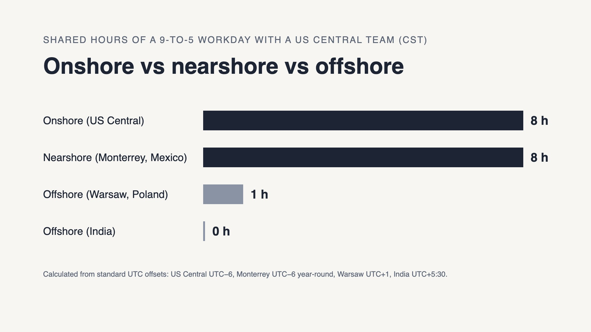

Nearshore, offshore and onshore engineering teams can all be senior and all use AI. The real difference is how many hours of the workday the team shares with the people who decide what gets built, and who is accountable when the software reaches production. For US product companies that need daily collaboration, nearshore engineers in Mexico and Latin America usually give the best balance of overlap, access and accountability. Offshore still fits work that is well specified and asynchronous, and onshore still fits roles that require on-site presence.

*Shared hours of a 9-to-5 workday with a team on US Central Standard Time. Source: Icalia Labs calculation from standard UTC offsets (Monterrey UTC−6 year-round, Warsaw UTC+1, India UTC+5:30).*

## The short answer

- **Choose onshore** when the role requires on-site presence, US-only data or system access, or a security clearance.
- **Choose nearshore** when the team needs to work in the same hours as US product and engineering leads, ship to production often, and meet in person for critical moments.
- **Choose offshore** when the work is well specified, can run asynchronously, or benefits from follow-the-sun coverage.
- **Choose nearshore forward deployed engineers** when the goal is a production outcome, not a staffed seat: senior engineers embedded in the team and accountable for what ships.

## What each model means

**Onshore** engineering means the engineers work in the same country as the client, whether employed directly or through a US vendor.

**Nearshore** engineering means the engineers work in a nearby country with a similar time zone. For US companies, that usually means Mexico and the rest of Latin America. Monterrey, where Icalia Labs has an office, runs on Central Standard Time year-round.

**Offshore** engineering means the engineers work in a distant region, most often South or Southeast Asia or Eastern Europe, usually 7 to 14 hours ahead of US Central time.

**A forward deployed engineer (FDE)** is an engineer embedded in the customer's team who owns outcomes in production. A nearshore FDE combines that operating model with the nearshore time zone.

## Nearshore vs offshore vs onshore: the comparison

| Factor | Onshore (US) | Nearshore (Mexico / LatAm) | Offshore (Asia / Eastern Europe) |
|---|---|---|---|
| Shared hours with a 9-to-5 US Central team | 8 | 8 in winter, 7 in US summer (6–7 with US Eastern and Pacific) | 0 (India) to about 1 (Eastern Europe) |
| In-person meeting for a critical decision | Same day | Short flight; Monterrey is close to Austin | Long-haul travel |
| Typical collaboration mode | Synchronous | Synchronous | Mostly asynchronous handoffs |
| Fit for daily product decisions | Strong | Strong | Weak unless one side shifts hours |
| Fit for well-specified, async work | Strong | Strong | Strong |
| Follow-the-sun coverage | No | No | Yes |

*Onshore, nearshore and offshore compared on the factors that change delivery. Shared hours: Icalia Labs calculation from standard UTC offsets.*

The overlap numbers come from plain arithmetic. A 9-to-5 day in US Central time runs from 15:00 to 23:00 UTC. In Monterrey, which stays on UTC−6 all year, that is the same 9-to-5 in winter; when the US moves to daylight saving time, the overlap drops to 7 hours. In India (UTC+5:30), a local 9-to-5 ends at 11:30 UTC, more than three hours before the US Central day starts. In Warsaw (UTC+1), the local day overlaps with the US Central morning by about one hour.

## Why time-zone overlap matters more with AI agents

AI coding tools are now standard. In the [2025 DORA report](https://cloud.google.com/blog/products/ai-machine-learning/announcing-the-2025-dora-report), 90% of respondents reported using AI at work, and 84% of developers in [Stack Overflow's 2025 Developer Survey](https://survey.stackoverflow.co/2025/ai) said they use or plan to use AI tools in development.

That changes where the bottleneck sits. When agents write a first version in minutes, the slow parts are reviewing the output, catching what is almost right, and deciding what to build next. In the same Stack Overflow survey, 46% of developers said they distrust the accuracy of AI output and 66% named "AI solutions that are almost right, but not quite" as their biggest frustration. DORA summarizes the effect in one line: "AI doesn't fix a team; it amplifies what's already there."

Both of those slow parts depend on fast conversations with the people who own the product. This is the clarity gap: the distance between what the business means and what gets built. An agent can widen it quickly. A senior engineer who can ask a product lead a question at 11 a.m. and get an answer at 11:05 closes it. With zero shared hours, the same question waits a full day, and so does every review loop that depends on it.

For teams running AI-assisted delivery, that is why overlap now matters more than it did when the main constraint was how fast humans could type code. Icalia Labs' engineering teams ship first versions to production in under one week and run from 10 to hundreds of changes per week through CI/CD; that pace depends on review and decisions happening in the same working day.

## Where offshore still wins

Offshore teams are a real option, and a fair comparison says when. Offshore fits work that is well specified and changes slowly, such as maintenance of stable systems, test automation against clear acceptance criteria, or data processing with defined rules. It also fits follow-the-sun support, where a team on the other side of the world covers the hours a US team is offline.

The trade-off is the handoff. Every unclear requirement becomes a round trip that costs a day. Teams that succeed offshore invest heavily in written specifications, overlapping on-call windows, or a US-based lead who works early or late to bridge the gap.

The gap shows up most after launch. Icalia Labs has seen it with more than one client whose engineering team works in a different time zone from the rest of the business. With AI-assisted delivery, those teams ship quickly. Supporting the live operation is harder: when something breaks, someone has to fix it while customers are using the product, working alongside the operations team in the same room or at least the same hours. When that support waits for the next workday on the other side of the world, the cost can range from frustrated consumer customers to strained B2B relationships, and a single B2B account can matter a great deal to a smaller company.

## Where onshore still wins

Onshore engineers remain the right call for roles that require physical presence, such as hardware labs or on-site operations, for work that needs US-only access to data or systems, and for roles that require a security clearance. Onshore is also the default for engineering leadership roles that sit inside the US executive team.

The constraint is supply and cost. The [U.S. Bureau of Labor Statistics](https://www.bls.gov/ooh/computer-and-information-technology/software-developers.htm) reports a median annual wage of $135,980 for software developers in May 2025, before benefits, and projects employment of software developers to grow 10% from 2025 to 2035, much faster than the average for all occupations. Many teams use both: a US core for leadership and on-site needs, and a nearshore team for capacity that works the same hours.

## The nearshore forward deployed engineer model

Nearshore forward deployed engineers are senior engineers in Latin America, time-zone aligned with US teams, embedded in the client's team and accountable for production outcomes. The difference from classic staff augmentation is ownership: an FDE is measured by what reaches production, not by hours logged or tickets closed.

In practice, that looks like this in Icalia Labs' [case studies](/case-studies.html):

- **EMR Bear**, a New Mexico healthcare company, worked with four specialized Rails engineers who put the first critical features in production within four weeks and kept shipping through the company's acquisition.
- **Everlance**, a San Francisco consumer startup, built with eight senior backend and native mobile engineers, and every engineer stayed through the acquisition.
- **Apply Digital**, a Canadian consultancy, stood up its first Latin American footprint, a 15-person team across Mexico and Colombia, through a Build/Operate/Transfer model in 6 to 12 months.

Vetting is part of the model. Fewer than 0.4% of applicants to Icalia Labs are accepted, at a senior+ bar, and the process is described in [how to vet nearshore engineers in the AI era](/blog/how-to-vet-nearshore-engineers.html).

The model fits regulated industries where the first weeks already touch sensitive systems, such as [fintech](/industries/fintech.html), [healthtech](/industries/healthtech.html) and [logistics](/industries/logistics.html), as well as aviation, airspace and mobility.

## How to decide: five questions

1. **How often does the team need a product decision?** Daily or more points to onshore or nearshore. Weekly or less can work offshore.
2. **How specified is the work?** Clear, stable specifications travel well across time zones. Discovery work does not.
3. **Does anyone need to be in the room?** On-site or clearance requirements point to onshore. Occasional in-person sessions for critical moments fit nearshore.
4. **Who is accountable for production?** If the answer is "our team, after handoff," the vendor is selling capacity. If it is "the embedded engineers, with us," that is the forward deployed model.
5. **How will AI change the work in the next 12 months?** If agents will write more of the first drafts, plan for more review and more decisions, and for the shared hours those need.

For the US side of hiring in the region, see [how to hire software engineers in Mexico](/blog/how-to-hire-software-engineers-in-mexico.html) and [how to evaluate an engineer's AI skills before hiring](/blog/how-to-evaluate-an-engineers-ai-skills.html). To see how embedded teams performed in production, read the [case studies](/case-studies.html), or [book a 30-minute call](/contact.html#book) to compare models for your next hires.
