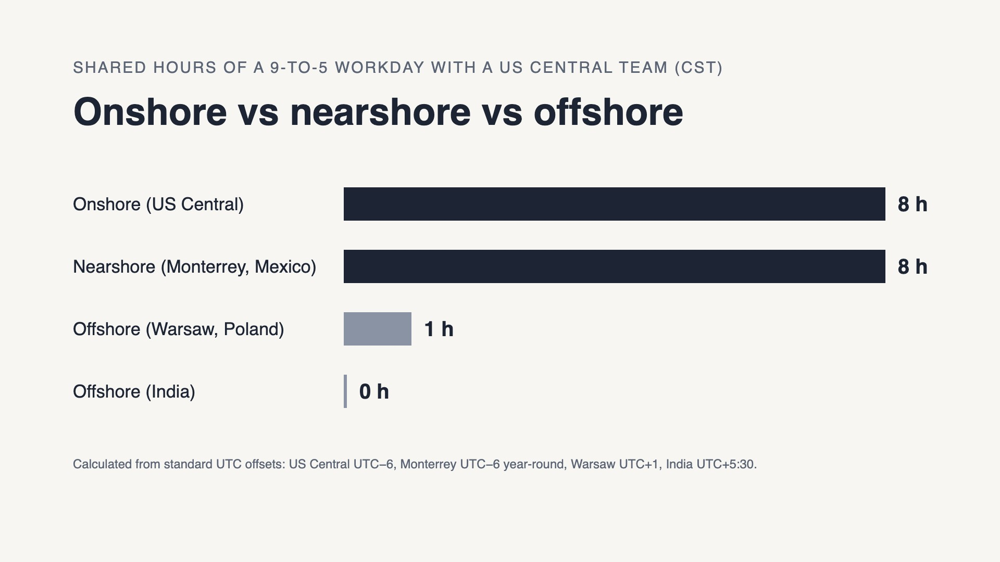

# Engineering Costs — Icalia Labs Blog

> What engineering capacity really costs — onshore, nearshore, and offshore — once you count ramp-up, retention, and management overhead.

1.  [Home](/)
2.  /
3.  [Blog](/blog/)

Topic

# Engineering Costs

What engineering capacity really costs — onshore, nearshore, and offshore — once you count ramp-up, retention, and management overhead.

[Talk to us about your budget →](/contact.html)

[

November 12, 2026

## Nearshore vs Offshore vs Onshore: How to Choose

How US engineering leaders can compare onshore, nearshore and offshore teams on time-zone overlap, accountability and AI-era delivery, and when each fits.

Forward-Deployed Engineering (FDE)

](/blog/nearshore-vs-offshore-vs-onshore.html)
